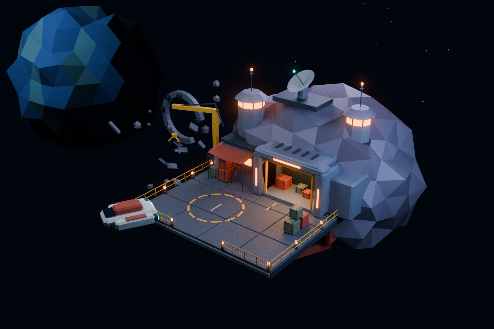

# Frontier Salvage Depot — Blender art study

Original modeled interpretation of the user's *Frontier Salvage Depot C2 Interface* reference. Created with Blender 4.3.2, without external assets, textures, or add-ons. It translates the visual language into editable 3D geometry; it is not an exact reconstruction of the image.



## Open and explore

Open [frontier_depot.blend](frontier_depot.blend) in Blender 4.3 or later. No Python execution or auto-run permission is required to open the generated file. The default viewport is perspective, oriented toward the front of the station.

- Middle-mouse drag: orbit freely around the scene.
- Mouse wheel or Ctrl + middle-mouse drag: zoom/dolly.
- Shift + middle-mouse drag: pan.
- Numpad `0`: enter/leave the active camera view.
- Numpad `.`: frame the selected object. Select `Dock | structural slab` in the Outliner to focus on the station rather than the distant planet.
- On a keyboard without a numpad, use View → Frame Selected and View → Cameras → Active Camera. The viewport navigation gizmo also offers orbit and zoom.
- Use Material Preview for quick editing. The rendered PNGs use the saved scene lighting, Cycles, and compositor glare; Material Preview's default studio lighting will differ.

The `08_Cameras` collection contains `CAM_Hero`, `CAM_Rear`, and `CAM_Underside`. Choose the camera in the Scene properties camera field, then enter its view with Numpad `0`. Return to ordinary viewport navigation to orbit independently of a camera.

The station is modeled on all sides and has dock supports below. The preview camera is not a camera-control implementation: collision avoidance, orbit limits, label occlusion, and responsive browser controls are future game work.

## Included files

| File | Purpose |
| --- | --- |
| `frontier_depot.blend` | Editable source scene, materials, preview lighting, and cameras |
| `frontier_depot.glb` | Geometry/material/anchor export for future renderer evaluation |
| `frontier_depot_preview.png` | Front three-quarter render |
| `frontier_depot_rear.png` | Rear inspection render |
| `frontier_depot_underside.png` | Underside inspection render |
| `create_frontier_depot.py` | Deterministic scene-generation script, seed 419 |
| `scene-report.json` | Basic scene diagnostics; not a browser performance benchmark |

## Scene structure

1. `01_Station`: deck, hangar, buildings, operations tower, dish, crane, cargo, railings, lights modeled as fixtures, rear services, and underside bracing.
2. `02_Asteroid`: fully volumetric faceted rock with per-face color variation.
3. `03_Player_Ship`: separate `Nomad_Mk_I | assembly` root with editable hull and engines.
4. `04_Salvage`: broken structural ring, hull fragments, and rocks.
5. `05_Backdrop`: decorative planet and star objects, excluded from the GLB.
6. `06_Interaction_Anchors`: named empty objects with `hotspot_id` and `display_name` custom properties. They do not execute interactions.
7. `07_Lighting`: Cycles preview lights, excluded from the GLB.
8. `08_Cameras`: front, rear, and underside inspection cameras, excluded from the GLB.

Dimensions use meters as an authoring convention, not a finalized game scale. The ship deliberately remains separate from the station so it can be repositioned later. Nothing is animated or rigged for gameplay.

## Rebuild

Run from the repository root with Blender installed:

```bash
# Rebuild .blend, .glb, diagnostics, and all three preview images.
blender --background --threads 8 --python Design/Blender/create_frontier_depot.py -- --all-views

# Rebuild and render only the main view.
blender --background --threads 8 --python Design/Blender/create_frontier_depot.py -- --render

# Rebuild assets without rendering.
blender --background --threads 8 --python Design/Blender/create_frontier_depot.py
```

Outputs go beside the generator, regardless of working directory. Rebuilding replaces the generated `.blend`, `.glb`, and diagnostic report, plus any renders requested. Save hand edits to a differently named `.blend` before rebuilding. The generator clears only its own running Blender scene; use background mode as shown rather than executing it inside an unsaved editing session.

The scene uses 96 Cycles samples and no denoising because this environment's Blender build lacks OpenImageDenoise. Adjust sample count locally if a final render needs less noise.

## Browser handoff and limits

The GLB includes station, asteroid, ship, salvage, basic materials, and interaction anchors with extras. It excludes cameras, preview lights, the distant planet, stars, and Blender post-processing. The future renderer must provide lighting/background, camera controls, interaction/UI, and any bloom effect. Emissive materials do not automatically light nearby objects.

This is an editable art study with many separate mesh objects. Before production, profile and optimize through merging static geometry, instancing repeated props, culling, texture/geometry compression, and reviewing glTF materials in the chosen renderer. No browser frame rate, load time, or collision behavior has been validated. Do not infer game readiness from an export.

See [the visual style guide](../Visual-Style-Guide.md) for art direction, camera requirements, provisional performance budgets, and review criteria.

## Validation performed

The saved `.blend` reopened successfully in Blender 4.3.2. The GLB was parsed and reimported successfully into a fresh Blender scene, preserving all four hotspot IDs and omitting preview lights, cameras, and backdrop. The exported geometry contains 10,920 triangles and 266 mesh resources in a 998,888-byte file. These counts describe this study, not draw calls or measured browser performance.
