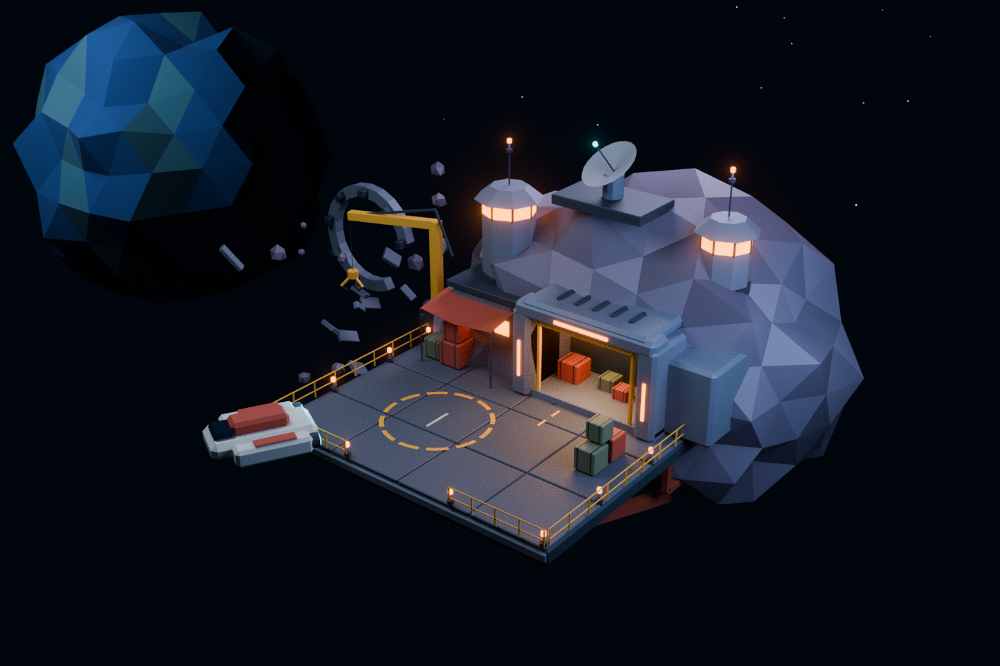

# Space Nomad — Visual Style Guide

Status: v0.1, first art-direction study. Based on the user-supplied *Frontier Salvage Depot C2 Interface* image. The image is a visual reference, not a specification for every HUD system shown in it.

## Direction and decisions

**A small, warm refuge built into a cold, faceted universe.** Chunky industrial forms, readable silhouettes, amber habitation lights, and restrained cyan navigation communicate frontier ingenuity and the possibility of ownership.

Confirmed: the player can freely rotate and zoom around the station. Use actual 3D location geometry, including the back and underside. A single rendered background or normal-mapped plane cannot support this camera. Keep the broader sector navigation distinct from this local station view.

Art production and a Blender scene study are authorized. This does not authorize implementation of the game, browser renderer, or server. The supplied Blender scene is an editable interpretation, not a pixel-perfect reconstruction or a production-ready asset pack.

## Shape and composition

| Element | Language | Avoid |
| --- | --- | --- |
| Asteroid | Large angular silhouette, broad irregular facets, muted purple-gray faces | Dense noisy displacement and rounded clay surfaces |
| Station | Modular chamfered boxes, structural beams, exposed service runs | Floating details with no supports, overly elaborate greebles |
| Dock | Wide functional deck, inset landing marking, perimeter safety rails | Tiny pad that cannot visibly accommodate the ship |
| Habitation | Amber windows and lit entrances, small practical awnings | Identical glowing panels on every surface |
| Salvage | Broken structural ring, identifiable hull fragments, sparse floating rock | Uniform clouds of anonymous debris |
| Player ship | Compact cream hull, vermilion accents, dark canopy, paired cyan engines | A warship silhouette or a fleet dominating the location |

Primary read: docking platform and hangar. Secondary read: station operations tower and crane. Tertiary read: cargo, railings, conduits, and salvage. Leave negative space around the ship and between interactive areas.

Use three scales of detail: large masses (~70% of the visual read), functional structures (~25%), and small accents (~5%). These are composition heuristics, not polygon allocations. Preserve recognizable silhouettes when the image is reduced to 320 pixels wide.

Build distinct rear and underside silhouettes: rear service modules, rock attachment points, dock trusses, and pipes. Free orbit must reveal authored structure rather than a hollow façade. The background planet and stars are set dressing, never navigable objects in the local view.

## Palette

Hex values are sRGB art swatches; shader values require conversion to linear color. Let lighting create variation before adding more materials.

| Role | Swatch | Use |
| --- | --- | --- |
| Deep space | `#071525` | Backdrop and negative space |
| UI surface | `#081E29` | Dark panel foundation |
| Navigation cyan | `#62E8F0` | Selection, interactive indicators, engines |
| Industrial amber | `#FFB52E` | Rails, landing paint, working lights |
| Warm emission | `#FF8A24` | Windows, beacons, entrance strips |
| Rock | `#696075` | Purple-gray asteroid with lighter/darker facets |
| Hull steel | `#747D90` | Station panels and beams |
| Structural shadow | `#293846` | Supports, machinery, recesses |
| Hull ivory | `#DBDED9` | Player ship and select station accents |
| Vermilion | `#B74735` | Awnings, ship identity, occasional pipework |
| Cargo olive | `#69765A` | Crates and freight |

Reserve cyan mainly for player-facing interaction and technology. Amber belongs to the inhabited world. Color must be backed by shape, icon, or text when it conveys a state.

## Materials and textures

Flat-shade rock faces. Use small real bevels on manufactured objects so lighting catches edges. Keep metals mostly rough, with selective moderate metallic response; avoid making every surface chrome. Use Principled BSDF materials and simple emission compatible with glTF.

For this first study, material colors and geometry provide detail; no external textures are required. Later, use a small shared trim sheet/atlas for panel seams, warning stripes, labels, and restrained wear. Normal maps can add small panel detail but cannot replace the silhouettes, platform supports, or rock volume needed for orbiting.

If baking normals later, triangulate consistently, use tangent-space maps, document the target renderer's normal convention, mark normal textures as non-color data, and test them in the actual browser renderer. Do not paint strong directional shadows into albedo; the camera and lighting need to remain coherent.

## Lighting and atmosphere

Cool broad key/fill reveals facets; warm local lighting establishes habitation. Use emissive window and beacon materials plus a few real lights. Emission alone need not illuminate surrounding surfaces in a real-time renderer.

Keep dock markings readable without bloom. Bloom/glare is a restrained finishing effect, never the source of shape. Use a dark navy environment rather than pure black. Avoid heavy fog that hides interaction targets or blurs the low-poly language.

The Blender study uses Cycles lighting and compositor glare for the preview. A future browser export requires its own lighting and post-processing setup; exporting geometry does not reproduce the Blender render automatically.

## Camera and interaction

Confirmed capability: full 360° horizontal orbit and zoom. Recommended default: perspective camera, roughly 40° above the deck, medium-wide framing, targeting the station rather than the distant planet. The supplied scene starts in a front three-quarter view and includes rear and underside inspection cameras.

Recommended game controls: drag to orbit, wheel/pinch to zoom, a visible reset-view action, and keyboard alternatives. Vertical orbit should support inspection above and below; prevent exact pole singularities and keep an upright horizon rather than allowing accidental roll. No fixed-camera dependency. Pan and focus-on-selected are useful later, not mandatory game features yet.

Future runtime rules: use station-relative zoom limits, prevent camera clipping into the asteroid, distinguish clicking from dragging, and preserve the player's camera when a panel opens. Initial zoom should show the whole station and ship. Raycast against actual location geometry; when a hotspot is behind the asteroid, hide its normal label and offer an explicit focus action rather than drawing it through the rock.

The Blender file supports free viewport orbit/zoom. It does not implement these game controls. Blender's standard navigation may pass through geometry; collision-aware browser camera behavior remains future work.

## Interface language

Keep HUD and labels out of the environment textures. Build them as responsive interface elements later. Use dark translucent panels, thin cyan strokes, clipped corners, a clear sans-serif body, and compact headings. Avoid long all-caps paragraphs and illegible decorative fonts.

Location labels need an anchor dot, short leader line, concise name, and clear hover/selected states. Allow labels to reposition to avoid overlap as the camera rotates. Provide non-color selection cues and readable text contrast. Validate actual contrast after compositing panels over the scene.

Only expose implemented systems: credits, components, cargo, objective, and available interactions. Fleet, faction, fuel, shield, and multiple currencies in the reference are not approved MVP requirements. Never turn art-reference chrome into accidental gameplay scope.

## Asset organization and delivery

- Source: [Blender/frontier_depot.blend](Blender/frontier_depot.blend).
- Reproducible generator: [Blender/create_frontier_depot.py](Blender/create_frontier_depot.py).
- Browser-oriented geometry/material study: [Blender/frontier_depot.glb](Blender/frontier_depot.glb).
- Preview and operating instructions: [Blender/README.md](Blender/README.md).

Use meters as a consistent authoring convention, Z up in Blender, and meaningful object/collection names. Mark interactive anchors with stable `hotspot_id` properties. glTF exports use their own Y-up convention; inspect transformed anchors in the eventual renderer. Ship, environment, background, lighting, and interaction anchors remain separate collections.

Before production, agree a target laptop/browser and profile an actual scene. Provisional budgets to test: <=150k visible triangles, <=150 draw calls after batching, <=20 MB initial compressed location payload, and stable 30 FPS at 1080p on the agreed baseline. These are proposed budgets, not measured achievements. The editable study deliberately keeps objects separate; it needs batching/instancing and export review before shipping.

## Review checklist

- Recognizable depot, ship, salvage field, and operations silhouette at a glance.
- Warm refuge/cold space contrast, with cyan reserved for navigation and technology.
- Front, rear, and underside contain intentional forms; orbit reveals no missing façade.
- Dock can visibly fit the player ship and has structural support.
- Lighting, not high-frequency texture noise, explains most surface detail.
- Interface remains separate; navigation survives rotation and occlusion.
- Do not infer gameplay completion from an art study or successful export.

## Decision log

1. Replaced the earlier fixed/2.5D presentation proposal with a 3D station location and freely orbiting, zoomable camera, at the user's request.
2. Retained the narrative/contract/ship-management gameplay and solo server-authoritative scope.
3. Created an editable art study before selecting a browser renderer or building game systems.
