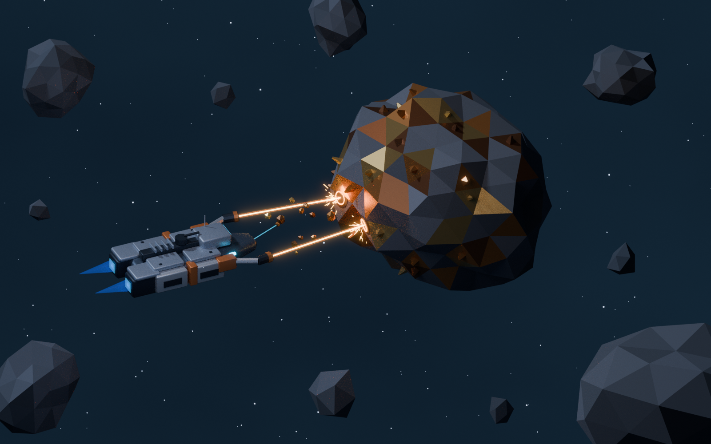

# Asteroid Mining — starter frigate vignette

The starter frigate extracts metallic ore from a faceted asteroid in open space. Two forward mining tools cut into the actual rock surface, with hot contact rims, sparks, extracted ore chips and a subtle cyan retrieval tether. Short blue drive plumes indicate stationkeeping. There is no station, cruiser or HUD.



Art direction: [SpaceNomad Visual Style Guide](../../Docs/Visual-Style-Guide.md).

## Files

- `asteroid_mining.blend`: editable Blender 4.3+ scene, camera, lights and effects.
- `asteroid_mining_preview.png`: rendered overview.
- `mining_frigate.glb`: the starter frigate with retracted gear, closed bays and attached mining equipment.
- `ore_asteroid.glb`: reusable metallic-ore asteroid, outcrops and target sockets.
- `asteroid_field.glb`: surrounding rocks and loose ore fragments.
- `mining_effects.glb`: separate static beam, spark, contact and drive-effect meshes.
- `starter_frigate_source.blend`: unmodified starter-frigate collection library; append its `Frigate` collection to reuse it.
- `create_scene.py`: deterministic scene generator, seed 2267.
- `scene_manifest.json`: export statistics and mining validation results.

## Rebuild

```sh
blender -b -t 8 --python create_scene.py
```

The local source library makes the folder self-contained. The first build can also extract it from the sibling `OrionFringe/orion_fringe.blend`. The source library and the outpost scene are preserved; flight configuration changes apply only to the mining scene's appended objects.

Optional environment variables: `SCENE_OUTPUT` changes the output directory, `RENDER_SAMPLES` controls Cycles samples, `RENDER_SCALE` controls resolution percentage, and `SKIP_RENDER=1` builds the scene and exports without rendering. No external textures or add-ons are needed.

## Import and interaction points

Blender uses Z-up, ship-local +Y forward and metre units, consistent with the outpost scene. GLB exports use Y-up and retain scene placement. `Frigate_ROOT` and `OreAsteroid_ROOT` are assembly pivots. Move the ship root to the origin to create a standalone prefab. Mining tools are separate objects parented to the ship. Named `MiningEmitter_L/R` and `MiningTarget_L/R` empties mark the drill origins and surface contacts.

This is a static mining composition for the game's visual foundation. The effect meshes make extraction readable in the Blender render; replace them with the target engine's beam, particle and material effects as needed. Game targeting, damage, ore depletion, inventory and collection logic are not implemented. Backdrop, camera and lights remain in Blender and are excluded from gameplay GLBs.

## Checks

The generator checks hull-to-rock separation, casts each mining beam against the actual asteroid mesh, verifies that it ends at its surface, and ensures no station, cruiser or deployed landing gear is present. The manifest records hit positions and the measured minimum hull separation. Review the preview alongside these geometry checks when changing the composition.
