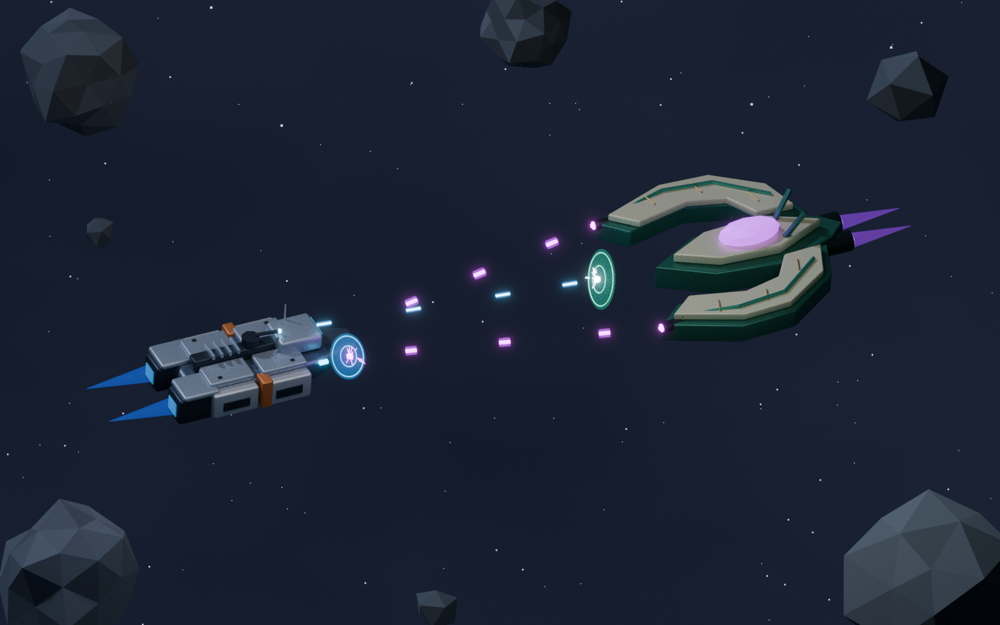

# Frigate Combat — human versus Veyr

The same human starter frigate exchanges fire with a peer-sized alien frigate in open space. The human ship retains its blue-grey armor, orange bands and twin engines. The Veyr opponent introduces a broad crescent silhouette, jade structure, ivory carapace plates, bronze seams and a faceted command crystal.

Veyr is a working name for this alien visual concept. Its plasma weapons and drives use violet/magenta, contrasting with human blue-white pulse fire and blue engines. Both ships remain intact; localized shield patches and energy ripples show incoming hits. Background asteroids frame the duel without blocking the firing corridor. There is no station or HUD.



Art direction: [SpaceNomad Visual Style Guide](../../Docs/Visual-Style-Guide.md). Other scenes: [Orion Fringe](../OrionFringe/README.md), [Asteroid Mining](../AsteroidMining/README.md).

## Files

- `frigate_combat.blend`: editable Blender 4.3+ combat scene, overview camera and lighting.
- `frigate_combat_preview.png`: rendered overview.
- `human_combat_frigate.glb`: the original starter hull in flight configuration, with its existing defense turret aimed at the opponent.
- `veyr_frigate.glb`: the new alien frigate, armor, emitters and drive cores.
- `battle_effects.glb`: separate static pulse bolts, plasma bolts, shield patches, energy arcs, flashes and exhaust.
- `asteroid_field.glb`: background asteroid geometry.
- `starter_frigate_source.blend`: unchanged starter-frigate collection library.
- `create_scene.py`: deterministic scene generator, seed 2268.
- `scene_manifest.json`: export statistics, root separation, shield contacts and weapon-emitter positions.

## Rebuild

```sh
blender -b -t 8 --python create_scene.py
```

The local ship library makes this folder self-contained. Append its `Frigate` collection to reuse the original asset. Combat configuration changes apply to the scene's appended copy; the source library and earlier scenes remain unchanged.

Optional environment variables: `SCENE_OUTPUT` selects the output directory, `RENDER_SAMPLES` controls Cycles samples, `RENDER_SCALE` sets resolution percentage, and `SKIP_RENDER=1` generates assets without rendering. No external textures or add-ons are required.

## Game import

Blender uses Z-up, ship-local +Y forward and the same working metre scale as the earlier scenes. GLBs use Y-up and retain scene placement. `Frigate_ROOT` and `VeyrFrigate_ROOT` are independent assembly pivots; move each root to the origin for standalone prefabs. `HumanWeaponEmitter` and `VeyrWeaponEmitter_1/2` empties mark the firing points.

Effects are separate from ship geometry. Use the named sockets and manifest positions to recreate projectiles and shield impacts in the target engine. This scene is a static combat illustration: AI, movement, targeting, weapon timing, damage, shield simulation and win conditions are separate gameplay work. The shield patches depict local impact regions rather than complete collision meshes.

## Checks

The generator validates three projectile contacts against analytic, ship-oriented ellipsoid shields. It also checks ship-root separation, equipment parenting and absence of deployed landing gear, mining equipment, the station and cruiser. The manifest records contacts and shield radii. The saved overview and exported assets are checked separately before publication.
