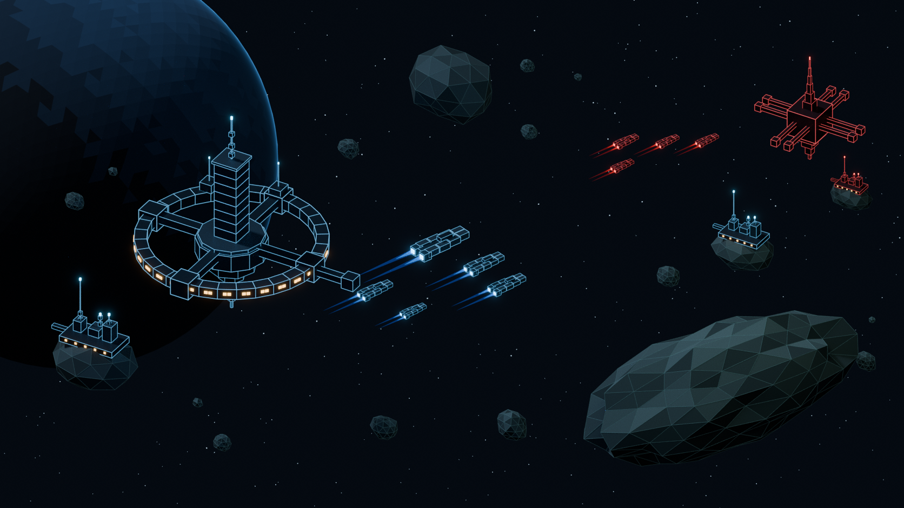

# Orbital Sector 7 — reference-inspired 3D sector

A completely new Blender scene interpreting the supplied tactical-space reference as a 3D environment. It includes the large blue ring station and tower, five blue patrol ships, four distant red patrol ships, a red command station, three asteroid installations, a faceted blue planet, scattered rocks and a large diagonal foreground asteroid.

The technical drawing appearance is part of the 3D materials and geometry: dark solid hulls have fine blue/red edge accents, rock facets have subtle teal edges, and windows and engines emit light. These are actual meshes under the same camera, rather than an image background or a screen overlay.



All HUD content is omitted: menus, resource counters, fleet list, health bars, minimap, selection cards, action buttons, selection rings, destination marker and dashed course line. These can be added later in the game engine.

## Files

- `orbital_sector_7.blend`: editable Blender 4.3+ scene, camera, lighting and procedural backdrop.
- `orbital_sector_7_preview.png`: rendered overview.
- `blue_ring_station.glb`, `red_command_station.glb`: separate station assemblies.
- `blue_fleet.glb`, `red_fleet.glb`: five blue and four red patrol vessels, with independent roots.
- `asteroid_outposts.glb`: three installations with their solid rock foundations.
- `asteroid_field.glb`: the large foreground rock and surrounding asteroids.
- `engine_effects.glb`: separate static blue/red exhaust plumes and trails.
- `create_scene.py`: self-contained deterministic generator, seed 2346.
- `scene_manifest.json`: composition, geometry statistics, axes and excluded overlays.

## Rebuild

```sh
blender -b -t 8 --python create_scene.py
```

The generator needs Blender only; no external models, textures, add-ons or source libraries are needed. It creates this scene independently of the earlier outpost, mining and combat scenes. `SCENE_OUTPUT` chooses the output directory, `RENDER_SAMPLES` controls Cycles samples, `RENDER_SCALE` sets resolution percentage, and `SKIP_RENDER=1` builds the scene and exports without rendering.

## Organization and import

Collections separate `BlueStation`, `RedStation`, `BlueFleet`, `RedFleet`, `Outposts`, `Asteroids`, `EdgeAccents`, `EngineEffects`, `Backdrop`, `Lighting` and `Cameras`. Reusable objects live under named `*_ROOT` assemblies. Ships use local +Y forward and Blender Z-up. The current working scale uses metre units. GLB export converts to Y-up and preserves the reference composition's placement.

Edge accents are physical thin tubes batched per assembly and color. Their roots follow the corresponding solid asset, and they are included with that asset's GLB. The separate Blender `EdgeAccents` collection makes them easy to hide, restyle or replace with an engine edge shader. Transparent engine plumes remain in a separate export. Planet, atmosphere, stars, camera and lights are Blender presentation assets, excluded from gameplay GLBs.

This is a static sector composition for the game's visual foundation. Formation movement, pathing, selection, resource systems and HUD are future engine work. The new patrol hulls match this reference's simplified block design rather than replacing the previously saved starter frigate or cruiser. For production, profile the edge treatment and consolidate materials or replace it with a suitable shader for the target platform.

Art direction: [Visual Style Guide](../../Docs/Visual-Style-Guide.md), including the Orbital Sector 7 technical treatment. Other scenes: [Orion Fringe](../OrionFringe/README.md), [Asteroid Mining](../AsteroidMining/README.md), [Frigate Combat](../FrigateCombat/README.md).
